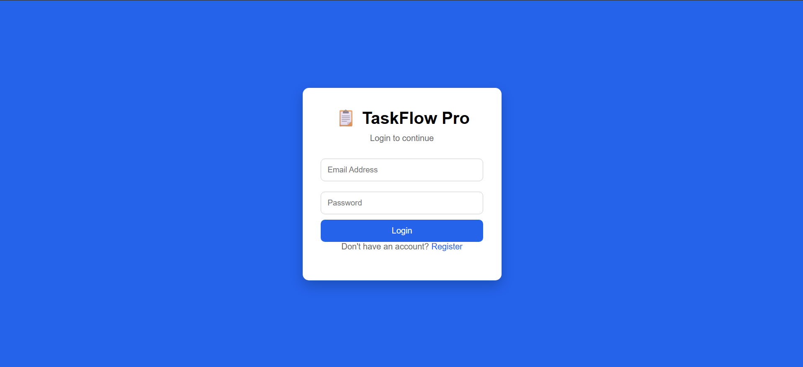
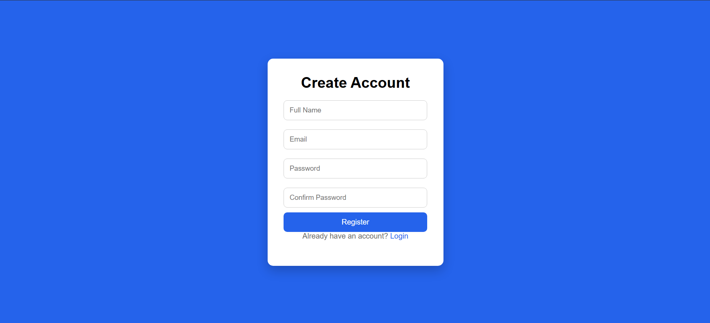
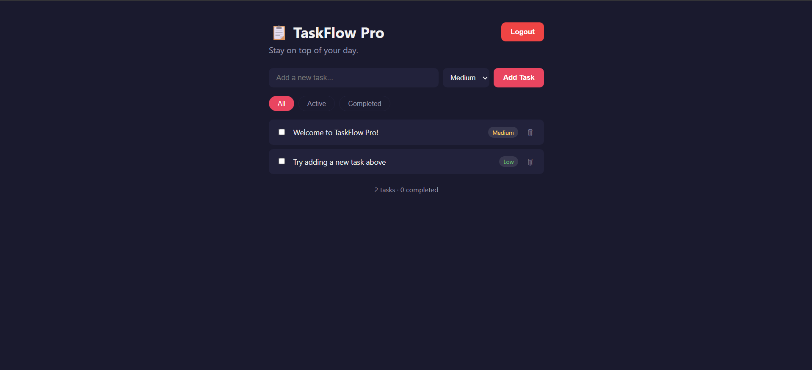

# TaskFlow Pro — RD Infro Technology Web Development Internship

A simple full-stack task management web app built for Tasks 1–4 of the
Web Development Internship.

## Folder Structure

```
TaskFlow-Pro/
│
├── Task1_Requirement_Gathering
├── Task2_UIUX_Wireframing
├── Task3_Frontend
│   ├── login.html
│   ├── register.html
│   ├── index.html
│   ├── auth.js
│   ├── script.js
│   ├── auth.css
│   └── style.css
│
└── Task4_Backend_API
    ├── server.js
    ├── users.json
    ├── middleware
    │   └── authMiddleware.js
    ├── routes
    │   ├── auth.js
    │   └── tasks.js
    └── package.json
```

## How to Run

### 1. Start the backend
```bash
cd Task4_Backend_API
npm install
npm start
```
This starts the API server at `http://localhost:5000`.

### 2. Open the frontend
Open `Task3_Frontend/index.html` directly in your browser
(or serve it with a tool like Live Server). It will automatically
fetch tasks from the backend running on port 5000.

## Features
✅ User Registration
✅ User Login
✅ JWT Authentication
✅ Secure Password Hashing (bcrypt)
✅ Protected REST APIs
✅ Add Tasks
✅ Delete Tasks
✅ Toggle Task Status
✅ Task Filtering
✅ Responsive UI
✅ Logout

## 🎥 Demo Video

[▶️ Watch the TaskFlow Pro Demo](demo/demo.mp4)

## Technologies Used
Frontend
- HTML5
- CSS3
- JavaScript

Backend
- Node.js
- Express.js
- JWT
- bcrypt
- CORS

Development
- VS Code
- Live Server
- Git & GitHub

## Screenshots
## Login Page



## Register Page



## Dashboard



## Credits
Built for the **Web Development Internship** at RD INFRO TECHNOLOGY.
>>>>>>> cd0d01d (Complete TaskFlow Pro with JWT authentication)
